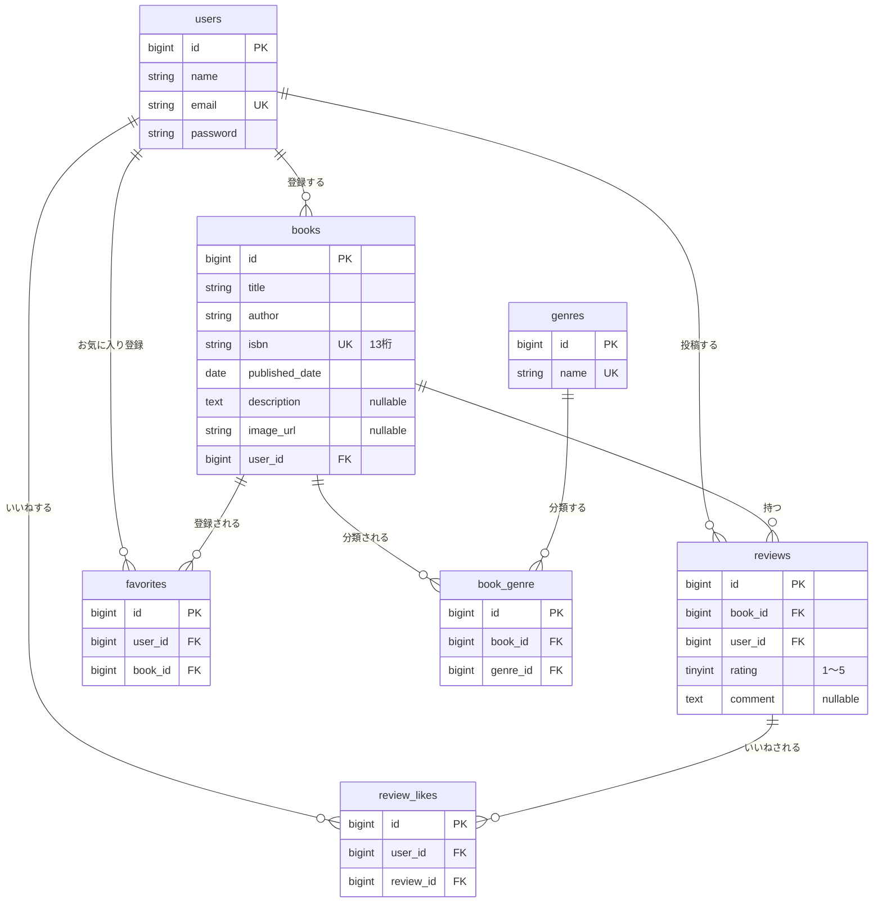

# BookShelf 書籍レビューアプリ

## 概要

書籍を登録・閲覧し、レビューの投稿やお気に入り登録ができる書籍レビューアプリです。
ジャンルによる分類、レビューへの「いいね」、平均評価に基づくランキングを備え、外部アプリケーション向けの公開API（JSON）も提供します。

COACHTECHの模擬案件として、Traditional Web（Blade + セッション認証）と公開APIの2構成で実装しています（本書は基本機能の範囲です）。

### 実装した機能

- 認証（会員登録・ログイン・ログアウト）: Laravel Fortify
- 書籍の一覧・詳細・登録・編集・削除（編集・削除は登録者のみ）
- レビューの投稿・編集・削除（編集・削除は投稿者のみ）
- ジャンルの一覧・詳細・登録・編集・削除（書籍が紐付くジャンルは削除不可）
- お気に入りの追加・解除、お気に入り一覧
- レビューへのいいね（追加・取り消し）
- 平均評価ランキング TOP10
- 公開API（書籍の一覧・詳細・登録・更新・削除、認証なし）

## 使用技術

| 種類 | 内容 |
|---|---|
| フレームワーク | Laravel 10.x |
| 言語 | PHP 8.5 |
| データベース | MySQL 8.4 |
| 認証 | Laravel Fortify |
| 環境 | Docker / Laravel Sail / phpMyAdmin |
| フロントエンド | Blade / Vite / Tailwind CSS ^3.4.0 / @tailwindcss/forms / Alpine.js |
| コード整形 | Laravel Pint |
| テスト | PHPUnit |

## 開発環境URL

| 内容 | URL |
|---|---|
| アプリケーション | http://localhost |
| phpMyAdmin | http://localhost:8080 |

## 環境構築手順

前提: Docker Desktop と Git がインストールされていること。

### 1. リポジトリを取得する

```bash
git clone https://github.com/kaochin42/bookshelf_app.git
cd bookshelf_app
```

### 2. 環境変数ファイルを用意する

```bash
cp .env.example .env
```

`.env` のデータベース設定が以下と一致していることを確認します。
`DB_HOST` は `localhost` ではなく、Dockerコンテナ名の `mysql` を指定します。

```
DB_CONNECTION=mysql
DB_HOST=mysql
DB_PORT=3306
DB_DATABASE=laravel
DB_USERNAME=sail
DB_PASSWORD=password
```

### 3. PHPの依存パッケージをインストールする

```bash
docker run --rm -u "$(id -u):$(id -g)" -v "$(pwd):/var/www/html" -w /var/www/html -e COMPOSER_CACHE_DIR=/tmp/composer_cache laravelsail/php82-composer:latest composer install --ignore-platform-reqs
```

### 4. Sailを起動する

```bash
./vendor/bin/sail up -d
```

> Apple Silicon（M1/M2/M3）のMacで `no matching manifest for linux/arm64/v8` が出る場合は、`compose.yaml` の `mysql` サービスに `platform: 'linux/amd64'` を追加してください。

以降のコマンドを短く書くため、任意でエイリアスを設定します。

```bash
echo "alias sail='[ -f sail ] && bash sail || bash vendor/bin/sail'" >> ~/.zshrc
exec $SHELL
```

### 5. アプリケーションキーを生成する

```bash
sail artisan key:generate
```

### 6. テーブル作成と初期データの投入

```bash
sail artisan migrate --seed
```

やり直す場合（全テーブルを作り直して初期データを再投入）:

```bash
sail artisan migrate:fresh --seed
```

### 7. フロントエンドをセットアップして起動する

```bash
sail npm install
sail npm run dev
```

`sail npm run dev` は開発中ずっと起動したままにしてください。
このターミナルは開いたままにして、他のコマンドは別のターミナルで実行します。

### 8. ブラウザで確認する

http://localhost を開きます。

### 日本語化について

`config/app.php` の `locale` を `ja` にし、`lang/ja/` にメッセージファイルを手動で配置しています。
`laravel-lang/*` 系のパッケージは導入していません。

## ログイン用テストユーザー

初期データとして5名のユーザーが登録されます（パスワードはすべて `password`）。

| 名前 | メールアドレス |
|---|---|
| 山田太郎 | yamada@example.com |
| 鈴木花子 | suzuki@example.com |
| 田中一郎 | tanaka@example.com |
| 佐藤美咲 | sato@example.com |
| 高橋健太 | takahashi@example.com |

初期データ: ユーザー5件、ジャンル10件、書籍11件（登録者は山田太郎）、レビュー32件、お気に入り、いいね。

## 画面一覧

| 画面 | パス | 認証 |
|---|---|---|
| 書籍一覧（トップ） | `GET /` または `GET /books` | 不要 |
| 書籍詳細 | `GET /books/{book}` | 不要 |
| 書籍登録 | `GET /books/create` | 必要 |
| 書籍編集 | `GET /books/{book}/edit` | 必要（登録者のみ） |
| ジャンル一覧・詳細・登録・編集 | `/genres` 配下 | 必要 |
| レビュー編集 | `GET /reviews/{review}/edit` | 必要（投稿者のみ） |
| お気に入り一覧 | `GET /favorites` | 必要 |
| ランキング | `GET /ranking` | 不要 |
| ログイン | `GET /login` | - |
| 会員登録 | `GET /register` | - |

## APIエンドポイント一覧

ベースURL: `http://localhost/api/v1`（基本機能では認証なし）

| メソッド | パス | 概要 | 成功時 |
|---|---|---|---|
| GET | `/api/v1/books` | 書籍一覧を取得（keyword・genre_id・page・per_page で検索・絞り込み。1ページ20件） | 200 |
| GET | `/api/v1/books/{book}` | 書籍詳細を取得（ジャンル・レビューを含む） | 200 |
| POST | `/api/v1/books` | 書籍を登録（`user_id` が必要） | 201 |
| PUT | `/api/v1/books/{book}` | 書籍を更新 | 200 |
| DELETE | `/api/v1/books/{book}` | 書籍を削除（関連データも削除） | 204 |

- 存在しないIDは `404`（`{"error": "書籍が見つかりませんでした。"}`）
- バリデーションエラーは `422`（日本語メッセージ）

## テスト・コード整形

```bash
sail artisan test              # テスト実行
sail artisan test --coverage   # カバレッジ付き
sail bin pint --test           # コード整形チェック
```

## ER図



- `book_genre` は (book_id, genre_id)、`favorites` は (user_id, book_id)、`review_likes` は (user_id, review_id) の組み合わせが一意です。
- 書籍を削除すると、紐付くレビュー・お気に入り・ジャンル紐付けも削除されます。レビューを削除すると、紐付くいいねも削除されます。

## 作成者

田上 香織
